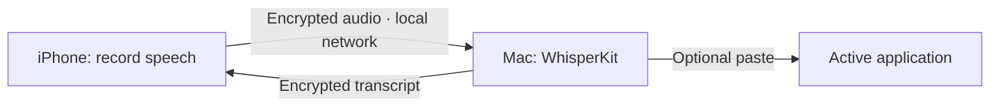

# Fala Dictation

**Speak into your iPhone. Transcribe on your Mac. Write in the app you're using.**

Fala Dictation is the MIT-licensed dictation core extracted from [Fala](https://github.com/FranciscoPereira2007/fala-app).
It pairs a small iPhone app with a Mac receiver: audio travels directly over your
local network in authenticated, encrypted messages, and WhisperKit transcribes
it on the Mac. No Fala account or paid transcription API is required.

This is an early developer release, built from source. It is a focused subset of
the larger Fala application, with separate bundle identifiers and preferences.

## What it does

- Records up to two minutes of speech on iPhone or iPad.
- Sends 16 kHz mono audio to your paired Mac using ChaCha20-Poly1305.
- Transcribes on the Mac using WhisperKit and a locally stored Whisper model.
- Returns the transcript to the phone and displays it on the Mac.
- Optionally pastes incoming dictation into the Mac's active application.
- Supports Portuguese and English transcription through the Mac language picker.

Pasting is **off by default**, resets when the Mac app restarts, and never sends
Enter. You can use the receiver purely for transcription and copy text manually.



## Requirements

- Apple Silicon Mac, macOS 14 or later; iPhone/iPad running iOS 18 or later.
- Xcode 16 or later, with the iOS platform installed.
- [XcodeGen](https://github.com/yonaskolb/XcodeGen) (`brew install xcodegen`).
- Both devices on the same network, with TCP port **47831** reachable on the Mac.
- Internet for Swift dependencies and the first model download. Once dependencies
  and model/tokenizer files are cached, transcription is designed to run locally.
- An Apple development signing team to install the phone app on a real device.
  A free personal team may be used subject to Apple's provisioning restrictions.

The default Mac model is Whisper large-v3 turbo. Allow several GB of free disk
space and memory for dependencies, builds and the model. First-use preparation
can take longer than a request's three-minute timeout; retry after it finishes.

## Build and use

```sh
git clone https://github.com/FranciscoPereira2007/fala-dictation.git
cd fala-dictation
swift test
xcodegen generate
open FalaDictation.xcodeproj
```

1. Select **FalaDictationMac → My Mac** in Xcode and Run. Keep its window open.
2. Select **FalaDictationPhone → your connected iPhone**. In Signing & Capabilities,
   select your own team. If required, change the phone bundle identifier to a
   unique identifier. Run, then allow microphone and local network access.
3. Enter the Mac's local IP address and its 26-character pairing code on the phone.
   The Mac window lists local interface addresses; choose its Wi-Fi/Ethernet
   address. Press **Test connection**.
4. Choose Portuguese or English in the Mac window. Record on the phone, then
   press **Stop and send to Mac**. Keep the phone app in the foreground.
5. Read the transcript on either device. To write directly into another app,
   grant the Mac app Accessibility permission, enable incoming paste and focus
   the desired text field before sending a recording.

Pairing details are entered afresh when the phone app starts. Changing the Mac
pairing code revokes the old code. Treat it as a password; do not publish it.

### Build without signing (compiler checks)

```sh
xcodegen generate
xcodebuild -project FalaDictation.xcodeproj -scheme FalaDictationMac \
  -destination 'platform=macOS' CODE_SIGNING_ALLOWED=NO build
xcodebuild -project FalaDictation.xcodeproj -scheme FalaDictationPhone \
  -destination 'generic/platform=iOS Simulator' CODE_SIGNING_ALLOWED=NO build
```

Simulator builds validate compilation. A real phone and Mac are needed to
validate microphone capture, permissions, network discovery and pasting.

## Scope and current limits

This release covers **iPhone/iPad → Mac on a local network**. Android, Windows,
relay services, remote screens, accounts, background dictation, keyboards and
agent/shell control are outside this repository's release scope. Their presence
in the larger Fala product does not imply support here.

The receiver handles one transcription at a time. Recordings are not queued or
automatically retried. Keep the Mac awake. Guest Wi-Fi, firewalls and VPN routing
can prevent direct connections. Bonjour advertises the service, but this first
phone UI uses manual IP entry.

No performance or accuracy guarantee is made. Review dictated text before using
it, especially names, numbers and code. This protocol has not had an external
cryptographic audit.

## Privacy and security

There is no account service, telemetry, transcription API or public relay in
this code. The phone uses a temporary recording file, deleted after preparing
the upload or cancelling. The transcript stays in app memory until cleared or
the app exits. The Mac keeps the pairing code and model preferences locally;
the replay cache retains recent response bodies in memory. Entries older than
four minutes are pruned on the next request, and all entries disappear on exit.
The OS clipboard retains text when Copy or Paste is used.

WhisperKit downloads model/tokenizer resources on first use from its upstream
providers. That network activity is distinct from audio delivery, which goes
to the Mac address you enter. See [security](SECURITY.md) and the
[wire protocol](docs/PROTOCOL.md) for boundaries and limits.

## Contribute

Useful first contributions are installation reports, real-device bug reports,
tests for malformed messages and improvements to pairing. See
[CONTRIBUTING.md](CONTRIBUTING.md). Never include a pairing code, private audio
or a transcript you do not have permission to share in an issue.

## License and attribution

[MIT](LICENSE), copyright Francisco Pereira. Original protocol, audio codec and
Whisper integration were extracted and adapted from the Fala application.
WhisperKit, model weights, tokenizers and Apple SDKs remain under their own terms;
see [third-party notices](THIRD_PARTY_NOTICES.md).
